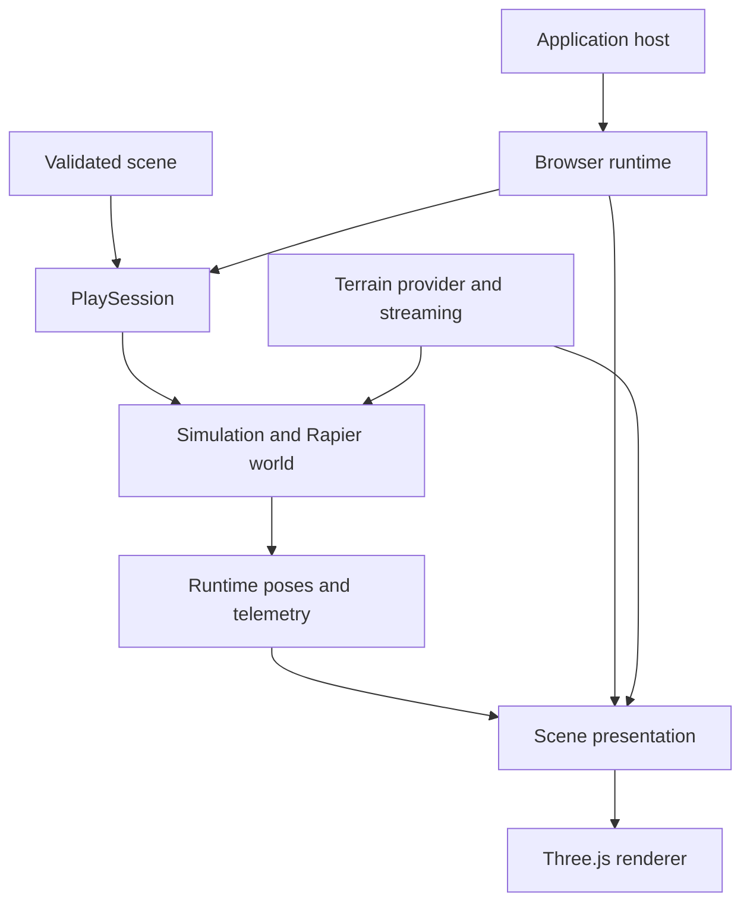

# 5. Architecture and module ownership

[Manual contents](README.md)

The central separation is between authored data, authoritative simulation, and
presentation. A saved document describes the intended scene. Simulation derives
mutable bodies and state from it. Presentation reads state and displays it. Saving
the original scene must not accidentally serialize a transient collision pose.

The diagram describes data and ownership flow, not a complete import graph.
Terrain presentation and terrain collision installation must refer to compatible
spatial data, but their work can have separate scheduling and distance budgets.

| Owner                      | Main responsibility                                               |
| -------------------------- | ----------------------------------------------------------------- |
| `entity/`, `scene/`        | Schemas, validation, transforms, scene transactions               |
| `simulation/`              | Physics, controllers, queries, transient state                    |
| `planet/`                  | Geographic math, contracts, assembly, terrain adaptation          |
| `render/`, `presentation/` | Visible objects, resources, effects, terrain views                |
| `runtime/`                 | Session and browser composition, input, camera, audio integration |
| `catalog/`                 | Concrete definitions and presentation choices                     |
| `game/`                    | Reference application and host-specific binding                   |

## Boundaries that affect changes

Simulation must not depend on the DOM or the renderer to advance physics. Rendering
must not import reference-game modules. The browser runtime deliberately owns DOM
listeners and GPU resources; older claims that _all_ engine code is DOM-free do not
describe this layer. Inspect [architecture tests](../../test/architecture) when
moving a feature between modules.

There is no universal public ECS spawn interface implied by the entity schema.
Use the available scene factories, catalog APIs, and runtime methods. Likewise,
the generic presenter and the stock presenter are distinct: the public
`SceneView` composition supplies stock instruments and presentation adapters.

## Practical ownership decision

Suppose a vehicle needs a retractable monitor. Store authored dimensions and
mounts in content, animate the visible assembly in presentation, and expose its
control through the runtime. If the extension changes collisions, update the
existing simulation body through the appropriate physics owner. Do not create a
second world just for the monitor, or infer its behavior from a display name.

## Source of truth

- [Module boundaries](../architecture/module-map.md).
- [Session](../../src/runtime/session.ts) and [browser composition](../../src/runtime/browser.ts).
- [Stock presenter](../../src/presentation/scene-view.ts).
- [Architecture regression suite](../../test/architecture).
